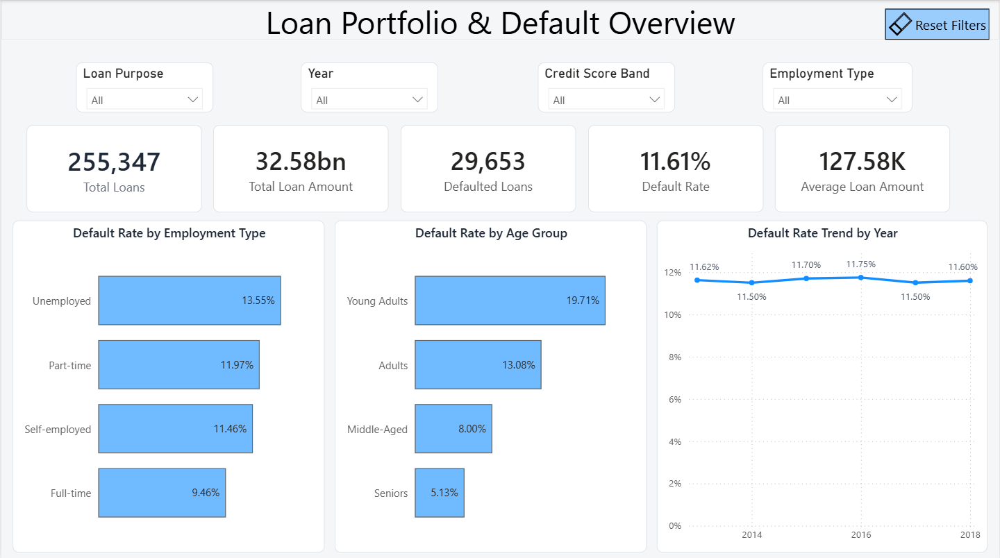
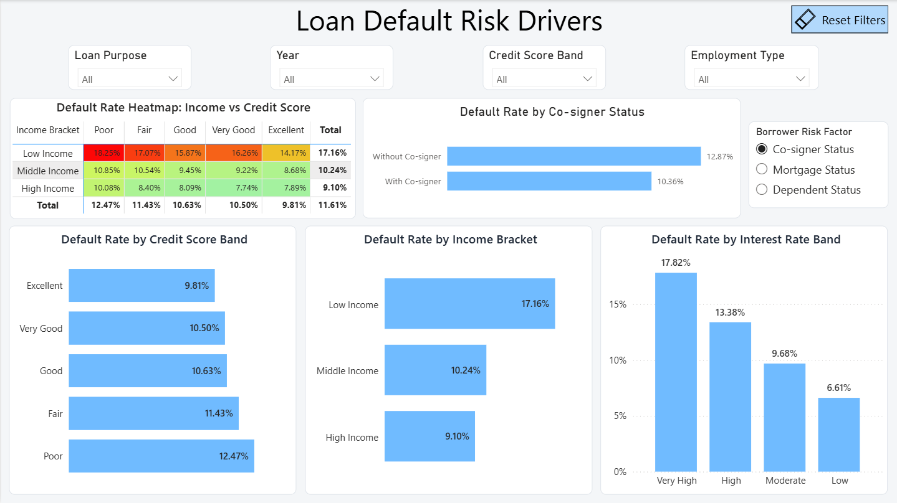
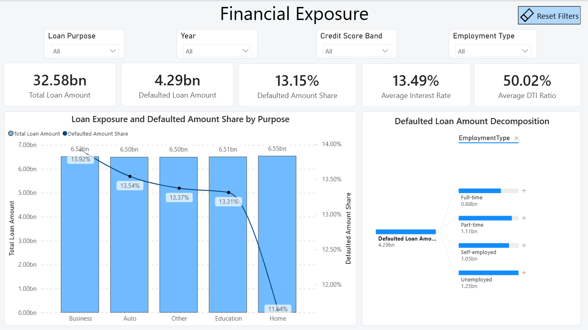
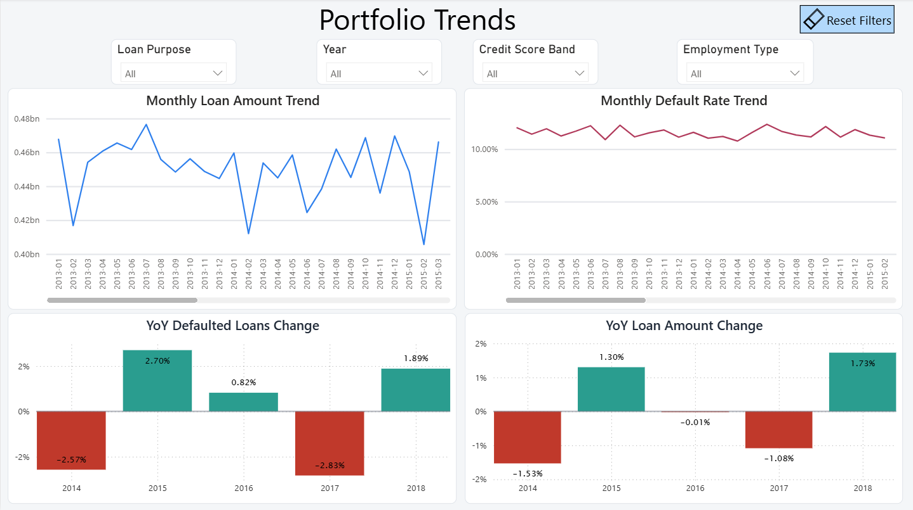
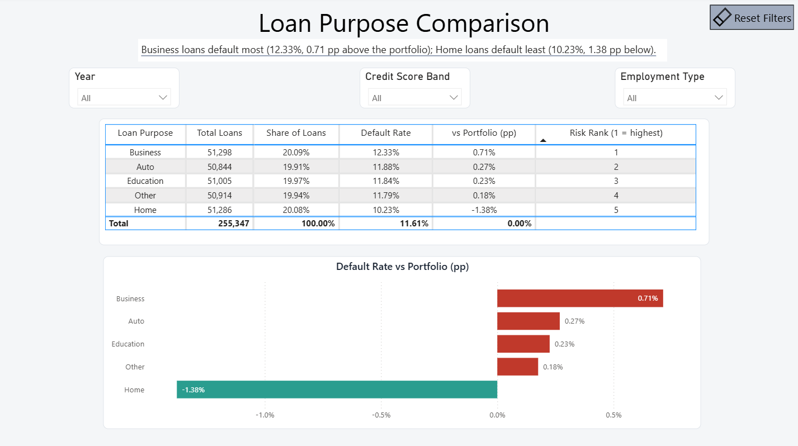
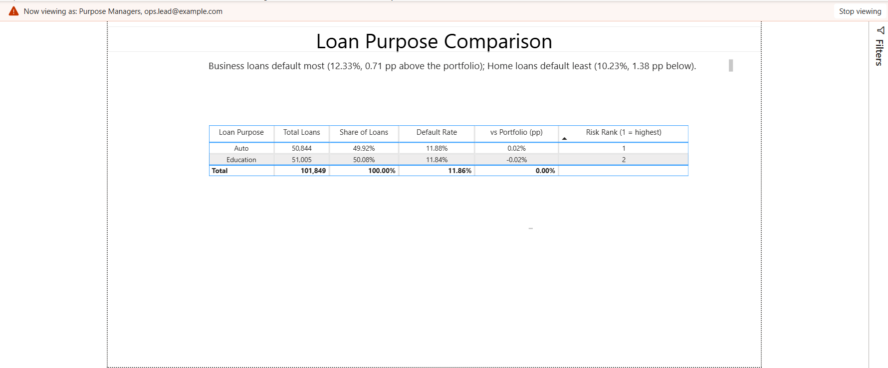
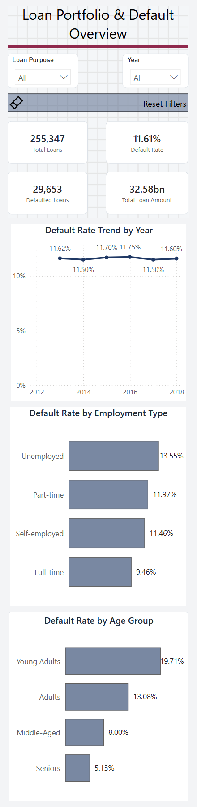
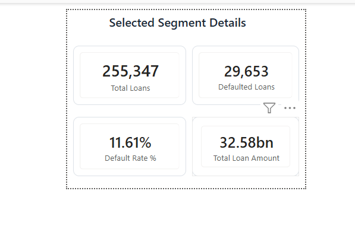

# Loan Default Risk Analysis

An end-to-end Power BI project analyzing a portfolio of **255,347 loans** to identify default-risk patterns, quantify defaulted exposure, and demonstrate time-intelligence reporting.

The report moves from an executive portfolio summary to borrower risk drivers, financial exposure, and monthly and yearly trend analysis. It also has a loan-purpose comparison page built on filter-context DAX, static and dynamic row-level security tested in Power BI Desktop, and a phone layout for the Executive Overview page.

## Walkthrough

A one-minute screen recording of the report in Power BI Desktop, showing cross-filtering, synced slicers, the Borrower Risk Factor field parameter, the report-page tooltip, decomposition-tree drill-down and the Reset Filters button.

https://github.com/user-attachments/assets/65466586-595a-4cb7-9301-5b38e11bdbb1

## Business objectives

- Measure the size and quality of the loan portfolio.
- Identify borrower segments associated with higher default rates.
- Compare default frequency with the share of loan amount in default.
- Analyze financial exposure across different loan purposes.
- Demonstrate monthly, YTD and year-over-year trend analysis with a dedicated Date table.
- Provide an interactive dashboard for segment-level analysis.
- Compare each loan purpose with the rest of the portfolio.
- Limit each manager to the loan purposes they are responsible for (row-level security).

## Data source

- Dataset downloaded from a Udemy data analyst course. It is based on a public Kaggle loan-default dataset (255,347 loans, 18 borrower and loan fields), with an added `Loan Date` column.
- The date column is labelled `Loan Date (DD/MM/YYYY)`, but its values are in MM/DD/YYYY format (for example, `10/15/2018`), so Power Query converts it using the English (United States) locale.
- The loan dates are spread evenly across 2013–2018 and are not linked to any other field. The Portfolio Trends page therefore demonstrates time intelligence (YTD, YoY and monthly trends) rather than real changes in lending over time.
- Amounts are shown without a currency because the source does not specify one.

## How I improved this report

A review of the first version of this report showed that the default rate by employment type divided each group's defaults by *all* loans instead of the loans in that group, and that several visuals showed loan volume rather than risk. I then rebuilt the report:

- Replaced the separate default-rate calculations with one reusable `Default Rate %` measure
- Added a marked Date table and moved all time calculations (YTD, YoY) onto it
- Combined three measure tables into one, organised with display folders
- Redefined the age, credit-score and income groups, with proper sort order
- Added the Default Risk Drivers page (with a field parameter), the Financial Exposure page, a report-page tooltip, synced slicers and reset buttons
- Checked every KPI against the source data

In a second round I added:

- A `Dim Loan Purpose` dimension table, so the model is a small star schema (Date and Loan Purpose dimensions around the loan fact table)
- Static and dynamic row-level security roles, tested with View as
- The Loan Purpose Comparison page with `ALLSELECTED`, `REMOVEFILTERS` and `RANKX` measures, a vs-portfolio bar chart and a takeaway sentence written by DAX
- A phone layout for the Executive Overview page and a custom report theme

## Recommendations (from this dataset)

The findings below are associations observed in this dataset, not proof of cause and effect.

**1. Review the highest-risk segments more closely.**
Young Adults default at 19.71% against a portfolio average of 11.61%, Low Income borrowers at 17.16%, and Very High Interest Rate loans at 17.82%. A lender could test tighter approval criteria or risk-based pricing for these segments.

**2. Test co-signer requirements for borderline applicants.**
Borrowers without a co-signer default at 12.87% compared with 10.36% for those with one, a 2.51 percentage point gap. This makes co-signer requirements worth testing, although the data alone does not show that co-signers reduce default.

**3. Size exposure by loan value, not only by loan count.**
Defaulted Amount Share (13.15%) is higher than the count-based Default Rate (11.61%), showing that defaulted loans carry above-average balances. Estimates based on loan counts alone would understate the value at risk.

**Limitation:** Defaulted Loan Amount represents defaulted exposure, not realised loss. The dataset contains no recovery or loss-given-default information, so these figures size exposure rather than final write-offs.

## Headline results

| KPI | Result |
| --- | ---: |
| Total Loans | 255,347 |
| Total Loan Amount | 32.58bn |
| Defaulted Loans | 29,653 |
| Default Rate | 11.61% |
| Average Loan Amount | 127.58K |
| Defaulted Loan Amount | 4.29bn |
| Defaulted Amount Share | 13.15% |
| Average Interest Rate | 13.49% |
| Average DTI Ratio | 50.02% |

Amounts are in the dataset's own units; the source does not specify a currency.

## Dashboard pages

### 1. Executive Overview

Provides a high-level summary of portfolio size, default performance, borrower employment risk, age-group risk, and annual default rates.



### 2. Default Risk Drivers

Analyzes default rates across credit score, income, interest-rate and borrower-status segments.

The Borrower Risk Factor field parameter allows users to switch dynamically between:

- Co-signer Status
- Mortgage Status
- Dependent Status



### 3. Financial Exposure

Compares total loan exposure with defaulted amount share by loan purpose. The decomposition tree allows users to investigate defaulted loan exposure through different borrower characteristics.



### 4. Portfolio Trends

Demonstrates time-intelligence measures built on the Date table:

- Monthly Loan Amount
- Monthly Default Rate
- YoY Loan Amount Change
- YoY Defaulted Loans Change

Because the loan dates are evenly distributed (see [Data source](#data-source)), this page shows how the measures work rather than real lending trends.



### 5. Loan Purpose Comparison

Compares the five loan purposes. The table gives the exact figures, and the bar chart shows each purpose's gap to the portfolio (red above, teal below). The Year, Credit Score Band and Employment Type slicers are synced with the other pages. There is no Loan Purpose slicer, because the page exists to compare all purposes against each other.

The sentence under the title is written by a DAX measure, so it changes with the slicers and with row-level security.



| Loan Purpose | Total Loans | Share of Loans | Default Rate | vs Portfolio (pp) | Risk Rank |
| --- | ---: | ---: | ---: | ---: | ---: |
| Business | 51,298 | 20.09% | 12.33% | +0.71 | 1 |
| Auto | 50,844 | 19.91% | 11.88% | +0.27 | 2 |
| Education | 51,005 | 19.97% | 11.84% | +0.23 | 3 |
| Other | 50,914 | 19.94% | 11.79% | +0.18 | 4 |
| Home | 51,286 | 20.08% | 10.23% | -1.38 | 5 |
| **Total** | **255,347** | **100.00%** | **11.61%** | | |

- `% of Total Loans` divides by the total under `ALLSELECTED('Dim Loan Purpose')`, so the shares add up to 100% of whatever the slicers leave visible.
- `Default Rate vs Portfolio` subtracts the default rate calculated with `REMOVEFILTERS('Dim Loan Purpose')`, which gives each purpose's gap to the portfolio in percentage points.
- `Default Rate Rank` uses `RANKX` over `ALLSELECTED`, inside `HASONEVALUE` so the total row stays blank.
- `Comparison Takeaway` finds the highest and lowest default rate among the visible purposes with `TOPN` over `ADDCOLUMNS ( VALUES ( ... ) )`, compares both with the portfolio and builds the sentence with `FORMAT`. For 2016 it reads: *Education loans default most (12.62%, 0.87 pp above the portfolio); Home loans default least (10.34%, 1.41 pp below).*

All values, including the 2016 figures, were checked against the source data.

## Row-level security

Both roles filter the `Dim Loan Purpose` table. The filter then reaches the loan fact table through the one-to-many relationship.

| Role | Type | Table filter (DAX) |
| --- | --- | --- |
| Home Loans Team | Static | `[LoanPurpose] = "Home"` |
| Purpose Managers | Dynamic | `[LoanPurpose] IN CALCULATETABLE ( VALUES ( UserAccess[LoanPurpose] ), UserAccess[Email] = USERPRINCIPALNAME() )` |

The dynamic role reads a hidden `UserAccess` table with one row per user and loan purpose. The emails are placeholders on example.com. The table has no relationship to the model; the role looks up the signed-in user's purposes with `USERPRINCIPALNAME()`, so one user can be given more than one purpose by adding rows.

| Email | Loan purposes |
| --- | --- |
| home.manager@example.com | Home |
| business.manager@example.com | Business |
| ops.lead@example.com | Auto, Education |

Tested in Power BI Desktop with **Modeling → View as**:

| Test | Result |
| --- | --- |
| Home Loans Team | Only Home loans shown |
| Purpose Managers, as ops.lead@example.com | Only Auto and Education shown: 101,849 loans, 11.86% default rate |



Under the role, Share of Loans and vs Portfolio are recalculated against the 101,849 loans this user can see, so the portfolio rate becomes 11.86% instead of 11.61%. The sentence rewrites itself to compare Auto and Education. Security filters are applied before the measures run, so `REMOVEFILTERS` and `ALLSELECTED` cannot bring back rows outside the role.

**Limitations**

- The roles were built and tested in Power BI Desktop only. The report has not been published to the Power BI Service (that needs a work or school account), so the roles are not assigned to real users.

## Mobile layout

The Executive Overview page has a phone layout: the title, Loan Purpose and Year slicers, the Reset Filters button, four KPI cards and the three charts, stacked for a narrow screen. The Employment Type and Credit Score slicers and the Average Loan Amount card are left out to keep the page short.



## Interactive tooltip

A dedicated report-page tooltip displays contextual KPIs when users hover over a chart category:

- Total Loans
- Defaulted Loans
- Default Rate
- Total Loan Amount



## Key findings

- **Young Adults** have the highest age-based default rate at **19.71%**.
- **Low Income** borrowers have a default rate of **17.16%**.
- Loans in the **Very High Interest Rate** band have a default rate of **17.82%**.
- **Unemployed** borrowers have the highest employment-based default rate at **13.55%**.
- **Poor Credit** borrowers default at **12.47%**, compared with **9.81%** for borrowers with excellent credit.
- Borrowers without a co-signer have a default rate of **12.87%**, compared with **10.36%** for borrowers with a co-signer.
- Borrowers without dependents have a default rate of **12.72%**, compared with **10.50%** for borrowers with dependents.
- Defaulted Amount Share is **13.15%**, higher than the loan-count Default Rate of **11.61%**. This indicates that defaulted loans tend to carry larger amounts than the portfolio average.
- Home loans have the lowest Defaulted Amount Share among loan purposes at **11.64%**.

## Power BI features implemented

- Power Query data cleaning, including locale-aware date conversion
- Dedicated Date table
- Active one-to-many relationship
- Centralized measure table
- Measure display folders
- DAX measures and calculated columns
- YTD and YoY time intelligence
- Monthly portfolio analysis
- Field parameters
- Dynamic visual titles
- Report-page tooltips
- Synced slicers
- Bookmark-based Reset Filters buttons
- Conditional formatting
- Positive and negative YoY colors
- Heatmap matrix
- Secondary Y-axis combination chart
- Decomposition tree
- Star schema with Date and Loan Purpose dimension tables
- Row-level security: static role and dynamic role with `USERPRINCIPALNAME()`
- `ALLSELECTED`, `REMOVEFILTERS`, `RANKX` and `HASONEVALUE` measures
- Dynamic text measure (`TOPN`, `FORMAT`) shown as a value in a text box
- Bar chart with rule-based conditional colours
- Phone (mobile) layout
- Custom report theme

## Data model

The semantic model contains:

- `Loan_default`: loan-level fact table
- `Date Table`: dedicated calendar table
- `Dim Loan Purpose`: one row per loan purpose, created with `DISTINCT ( Loan_default[LoanPurpose] )`
- `_Measures`: centralized measure table
- `Borrower Risk Factor`: disconnected field-parameter table
- `UserAccess`: hidden, disconnected security table used by the Purpose Managers role

The active relationships are:

```text
Date Table[Date]               1 ──────── *  Loan_default[Loan Date]
Dim Loan Purpose[LoanPurpose]  1 ──────── *  Loan_default[LoanPurpose]
```

Both relationships filter in a single direction, from the dimension to the loan fact table.

The Date table covers:

```text
01 January 2013 to 31 December 2018
```

## Data preparation

- Verified 255,347 loan records.
- Checked for missing values and duplicate rows.
- Converted `Loan Date` from MM/DD/YYYY text to a Date type using the English (United States) locale.
- Assigned appropriate numeric, text, and logical data types.
- Converted mortgage, dependent, co-signer, and default indicators to Boolean values.
- Created age, credit-score, income and interest-rate bands.
- Added numerical sort columns for ordered categories.
- Created and marked a dedicated Date table.
- Removed the redundant fact-table Year column.
- Hid technical sorting fields and raw Boolean columns.
- Organized measures into business-friendly display folders.

Detailed documentation is available in:

- [DAX Measures](documentation/DAX_Measures.md)
- [Data Dictionary](documentation/Data_Dictionary.md)
- [Data Preparation](documentation/Data_Preparation.md)

## Tools used

- Power BI Desktop
- Power Query
- DAX

## Repository structure

```text
Loan-Default-Risk-Analysis/
├── README.md
├── dashboard/
│   ├── README.md
│   └── Loan_Default_Risk_Analysis.pbix
├── data/
│   ├── README.md
│   └── Loan_Default_Dataset.xlsx
├── documentation/
│   ├── DAX_Measures.md
│   ├── Data_Dictionary.md
│   └── Data_Preparation.md
└── screenshots/
    ├── README.md
    ├── 01_executive_overview.png
    ├── 02_default_risk_drivers.png
    ├── 03_financial_exposure.png
    ├── 04_portfolio_trends.png
    ├── 05_interactive_tooltip.png
    ├── 06_loan_purpose_comparison.png
    ├── 07_rls_dynamic_view_as.png
    └── 08_mobile_layout.png
```

## How to use the project

1. Download or clone this repository.
2. Open `dashboard/Loan_Default_Risk_Analysis.pbix` in Power BI Desktop.
3. Set the `DataFolder` parameter to the full path of this repository's `data` folder, ending with a backslash (Home → Transform data → Manage Parameters), for example `C:\Users\you\Loan-Default-Risk-Analysis\data\`.
4. Refresh the Power BI model.
5. Use the slicers, borrower-risk selector, tooltips, and decomposition tree to explore the portfolio.
6. To test row-level security, go to **Modeling → View as** and pick a role. For Purpose Managers, also tick **Other user** and enter an email from the `UserAccess` table, for example `ops.lead@example.com`.

## Interpretation note

`Defaulted Loan Amount` represents the loan amount associated with defaulted records.

It should be interpreted as **defaulted exposure**, not realized financial loss, because the dataset does not contain recovery or loss-given-default information.

## Author

**Aditya Ranjan**

Data Analyst | Python · SQL · Power BI · Tableau

[LinkedIn](https://www.linkedin.com/in/aditya-ranjan-data) · [GitHub](https://github.com/beingbrute) · adityaranjan17302215@gmail.com
